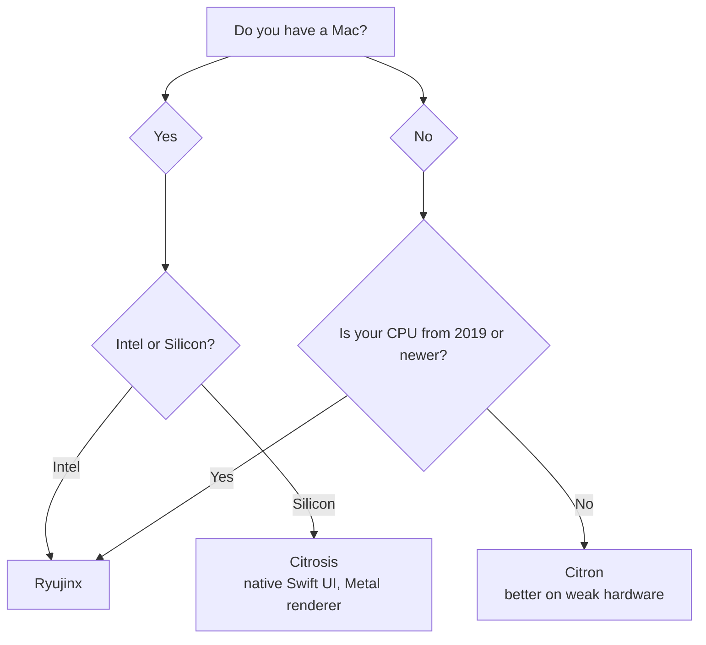

# GRID0+ emu

**Play Switch games online with friends over custom servers (GRID0+) OR a virtual LAN (GRID0). 
Emulator builds for Ryujinx and Citron (including Citrosis).**

**GRID0+:** Replaces NSO functionality for online matchmaking, Splatfests, and in-game progression. 
Works for cross-play with banned switch users. Runs on custom servers. More info at [GRID0+](https://github.com/GRID0-net/GRID0). 
**GRID0:** Replaces the old LAN-play relays with better stability, faster speeds, and an easier setup. 
Works for cross-play with unbanned and banned switch users. Runs on ZeroTier. More info at [GRID0](https://github.com/GRID0-net/GRID0).

#### Which emulator should I use?

<b>Flowchart</b>

<b>If the flowchart above doesn't render, use this:</b>

Are you using a Mac? (An Apple computer)

<table>
<tr>
<td valign="top">

<b>Yes</b>

<b>Intel or Silicon?</b> <a href="https://support.apple.com/en-us/HT211814">Check if your Mac has Apple Silicon or Intel</a>

<table>
<tr>
<td valign="top">

<b>Intel</b>

Considering you are on an Intel Mac, the best emulator for you is <a href="https://github.com/GRID0-net/GRID0-ryu"><b>Ryujinx</b></a>

</td>
<td valign="top">

<b>Silicon</b>

Considering you are on a Silicon Mac, the best emulator for you is <a href="https://github.com/GRID0-net/GRID0-citron/releases"><b>Citrosis</b></a> <i>(native Swift UI, Metal renderer)</i>

</td>
</tr>
</table>

</td>
<td valign="top">

<b>No</b>

<b>How old is your CPU?</b> <a href="https://en.wikipedia.org/wiki/List_of_Intel_processors">Look up your Intel CPU release date</a> · <a href="https://en.wikipedia.org/wiki/Table_of_AMD_processors">Look up your AMD CPU release date</a>

<table>
<tr>
<td valign="top">

<b>From 2019 or newer</b>

Considering you are on a relatively new non-Mac, the best emulator for you is <a href="https://github.com/GRID0-net/GRID0-ryu"><b>Ryujinx</b></a>

</td>
<td valign="top">

<b>Older than 2019</b>

Considering you are on a relatively older non-Mac, the best emulator for you is <a href="https://github.com/GRID0-net/GRID0-citron"><b>Citron</b></a>

</td>
</tr>
</table>

</td>
</tr>
</table>

## Setup Guide

Runs directly on the console as a background sysmodule. No PC or phone required while playing.

1. Download the latest release from the **[GRID0+ cfw](https://github.com/GRID0-net/GRID0plus-cfw/)** repository.
2. Extract the archive to the root of your SD card.

[image: the SD card root with the extracted sys-GRID0 folders in place]

**GRID0:**
3. Reboot into Atmosphere, (temporary step) Currently the network id isnt included with the release, so in ultrahand, insert the following network id on the sys-zerotier page (name is also not yet updated) : 8bd5124fd68185ec
4. Verify connection status using the Tesla (or Ultrahand) overlay menu.

[image: the Tesla overlay open on the Switch showing the sys-GRID0 connection status]

**GRID0+:**
3. Reboot into Atmosphere, open the HomeBrew Menu (Album), open the GRID0+ Toolbox and select Change to GRID0+ mode.
4. After your switch restarts, head to Settings > Users > Add A User > Not With Me > Yes, Had an Account > Link Account > Sign Into Your GRID0+ account using your Discord username and password from the bot.
5. Verify connection status using the Tesla (or Ultrahand) overlay menu.

[image: the Tesla overlay open on the Switch showing the sys-GRID0 connection status]

---

Built by 3 humans with limited AI assistance, tested on real Switches over many days and restless nights.
